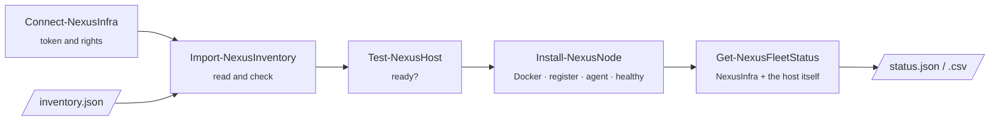

<div align="center">

[](https://github.com/Tombomeke-Studios/NexusFleet/actions/workflows/ci.yml)
[](https://github.com/Tombomeke-Studios/NexusFleet/actions/workflows/integration.yml)


**A PowerShell 7 module that turns fresh Linux machines into healthy [NexusInfra](https://github.com/Tombomeke-Studios/NexusInfra) nodes,
and keeps an eye on them as a fleet.**

[Quick start](#quick-start) · [What it does](#what-it-does) · [User guide](docs/user-guide.md) · [Documentation](#documentation) · [Development](#development)

</div>

---

## Why

Adding a machine to NexusInfra by hand takes four jobs:
- install Docker;
- start the agent container with four environment variables and five options, three of which fail **silently** when
  forgotten;
- register the node;
- check that it sends heartbeats.

That is tedious for one machine, error-prone for ten and unworkable for a hundred.

NexusFleet does it for a whole list of machines with **one command**. The same command can run again at any time:
whatever is already in order is left alone.

```powershell
Import-NexusInventory ./config/inventory.json | Install-NexusNode
```

## What it does



| Feature | What it means |
|---|---|
| **Idempotent** | Every step checks first whether it is still needed. A second run changes nothing. |
| **Rollback** | When a step fails on a host, what that run changed on that host is undone. |
| **Parallel** | Many hosts at the same time. One failing host never stops the others. |
| **Dry run** | `-WhatIf` shows the plan per host and changes nothing. |
| **A result per host** | Objects, not text: filter, sort, group and export them like any PowerShell output. |
| **Secrets stay secret** | Stored with SecretManagement and sent to a host over stdin, never on a command line. Redacted from every log. |
| **Readable logs** | One line per event, one file per host, for every run, a dry run included. |

### The installation, per host

| Step | Checks first | Then |
|---|---|---|
| **Preflight** | ssh login, Ubuntu, `sudo`, free disk space, Docker, the broker reachable from the host | a host that is not ready is left untouched |
| **Docker** | is Docker installed and running? | installs Ubuntu's `docker.io` |
| **RegisterNode** | is the node in NexusInfra, with the same name, location and agent URL? | `POST /nodes` |
| **AgentContainer** | does the agent run with every setting, including the three that fail silently? | writes `/etc/nexusinfra/agent.env` (mode 600) and starts the agent |
| **VerifyHealthy** | does NexusInfra report the node healthy? | waits until it does, or rolls back |

## Quick start

You need PowerShell 7.6+, `ssh` with a key the hosts accept, and a NexusInfra panel (v0.4.0+) with an API token of a
platform administrator. All requirements: [user guide](docs/user-guide.md#before-you-start).

```powershell
git clone https://github.com/Tombomeke-Studios/NexusFleet.git
cd NexusFleet
Import-Module ./NexusFleet.psd1
```

**1. Tell NexusFleet where your panel and broker are.** Create `config/nexusinfra.local.psd1` (git-ignored):

```powershell
@{
    Api    = @{ BaseUrl = 'https://panel.example.com' }
    Broker = @{ Host = '10.0.0.2' }      # the broker as the hosts reach it
}
```

**2. Connect, and describe your hosts** in `config/inventory.json`
([format](docs/inventory.md), example in [config/inventory.example.json](config/inventory.example.json)):

```powershell
Connect-NexusInfra -Token (Read-Host -AsSecureString 'API token') -Save
$hosts = Import-NexusInventory ./config/inventory.json
```

**3. Check, plan, install:**

```powershell
$hosts | Test-NexusHost   | Format-Table Host, Success, Step, Error
$hosts | Install-NexusNode -WhatIf
$hosts | Install-NexusNode | Format-Table Host, Success, Changed, Step, Error
```

```text
Host        Success Changed Step      Error
----        ------- ------- ----      -----
node-home01    True    True
node-home02    True    True
node-vps01    False   False Reachable preflight failed, nothing was changed: cannot reach 203.0.113.10:2222 ...
```

**4. See how the fleet is doing:**

```powershell
$hosts | Get-NexusFleetStatus | Format-Table Name, Ok, Health, AgentState, Problem
```

```text
Name        Ok    Health  AgentState Problem
----        --    ------  ---------- -------
node-home01 True  healthy running
node-home02 False offline exited     NexusInfra reports it offline; the agent container is exited
```

The agent's two secrets (`RABBITMQ_URL`, `INTERNAL_API_TOKEN`) are read from SecretManagement or passed as
parameters. The [user guide](docs/user-guide.md) walks through every step.

## Cmdlets

| Cmdlet | What it does |
|---|---|
| [`Connect-NexusInfra`](docs/user-guide.md#connect-nexusinfra) | Connects to the panel and checks, before anything else, that the token may manage nodes |
| [`Import-NexusInventory`](docs/user-guide.md#import-nexusinventory) | Reads and checks the list of hosts, and reports every problem at once |
| [`Test-NexusHost`](docs/user-guide.md#test-nexushost) | Checks whether each host is ready, in parallel, without changing anything |
| [`Install-NexusNode`](docs/user-guide.md#install-nexusnode) | Turns hosts into healthy nodes: idempotent, with rollback and `-WhatIf` |
| [`Get-NexusFleetStatus`](docs/user-guide.md#get-nexusfleetstatus) | NexusInfra's view of every node, merged with what ssh sees on the host |
| [`Export-NexusFleetStatus`](docs/user-guide.md#export-nexusfleetstatus) | Writes that status to JSON or CSV |

In the shell: `Get-Help about_NexusFleet`, and `Get-Help <cmdlet> -Full` for every cmdlet.

## Proven

Every pull request runs the whole flow for real in CI. The flow runs against a NexusInfra control plane and two fresh
Ubuntu hosts in Docker, plus one host that cannot be reached. The three criteria of the MVP are checked on every run.
From the demo script ([lab/demo/](lab/demo/README.md)):

```text
Phase                          Seconds
-----                          -------
Preflight (Test-NexusHost)         2.7
Plan (Install-NexusNode -WhatIf)   2.6
Install (Install-NexusNode)       14.9
Second run (Install-NexusNode)     2.6
Status (Get-NexusFleetStatus)      2.7

Criterion                                         Holds Detail
---------                                         ----- ------
1. one command turns the hosts into healthy nodes  True 2 of 3 host(s) installed; healthy now: node-lab1, node-lab2
2. a second run changes nothing                    True changed in the second run:
3. one failing host does not stop the others       True failed on their own: node-lab-broken (Reachable)
```

## Documentation

| For | Read |
|---|---|
| **Using NexusFleet** | [User guide](docs/user-guide.md) · [Inventory format](docs/inventory.md) · [Configuration](docs/configuration.md) · [Security](docs/security.md) · [Troubleshooting](docs/troubleshooting.md) |
| **Working on it** | [Architecture](docs/architecture.md) · [Development](docs/development.md) · [Testing](docs/testing.md) · [Labs](lab/README.md) |
| **The course (Dutch)** | [Project proposal](docs/projectvoorstel.md) · [Design decisions](docs/ontwerpkeuzes.md) · [Changes in NexusInfra](docs/nexusinfra-wijzigingen.md) · [Explanations per topic](docs/uitleg/README.md) |

Index of everything: [docs/README.md](docs/README.md).

## Development

```powershell
./tools/Install-NexusTooling.ps1              # once: the pinned Pester 5, PSScriptAnalyzer and SecretManagement
./tools/Invoke-NexusTests.ps1                 # unit tests with coverage, as CI runs them; report in TestResults/
./tools/Invoke-NexusLint.ps1                  # PSScriptAnalyzer with the repository's rules
./tools/Build-NexusModule.ps1                 # the shippable module in out/
```

| Workflow | Runs | What you see |
|---|---|---|
| [CI](.github/workflows/ci.yml) | every push and pull request | lint, and the unit tests on Linux **and** Windows: totals, every failure with its reason and `file:line`, coverage per file |
| [Integration](.github/workflows/integration.yml) | pull requests and pushes to `dev`/`main` | the real flow against the labs in Docker, with every log kept as an artifact |
| [Release](.github/workflows/release.yml) | a `v*` tag on `main` | the checks, the build, and a GitHub release with the zip |

Branches: `feature/<topic>` → `dev` (always green) → `main` (milestones, tagged). More in
[development.md](docs/development.md) and [testing.md](docs/testing.md).

## Repository layout

```text
NexusFleet/
├── NexusFleet.psd1 / .psm1   manifest (explicit exports) and loader
├── src/
│   ├── core/                 the step runner, contracts and the per-host engines (preflight, install, status)
│   ├── steps/                one file per installation step: Docker, RegisterNode, AgentContainer, VerifyHealthy
│   ├── transports/           running a command on a host over ssh
│   ├── api/                  the only caller of the NexusInfra REST API
│   ├── utils/                config, logging, secrets, the shared per-host loop
│   └── public/               the exported cmdlets
├── config/                   every NexusInfra-specific value, and an example inventory
├── en-US/                    about_NexusFleet
├── tests/                    Pester 5, mirroring src/, plus tests about the tests
├── tools/                    lint, tests, report, build, tooling: the same locally and in CI
├── lab/                      the experiments, the node lab and the demo (not part of the module)
└── docs/                     English documentation and the Dutch course documents
```

Every folder has its own README with the details.

## About

A school project for *System Automation & Scripting* (EhB, Toegepaste Informatica) by Tom Dekoning, from
[Tombomeke Studios](https://github.com/Tombomeke-Studios). [NexusInfra](https://github.com/Tombomeke-Studios/NexusInfra) is
a separate project, and not part of this module.


